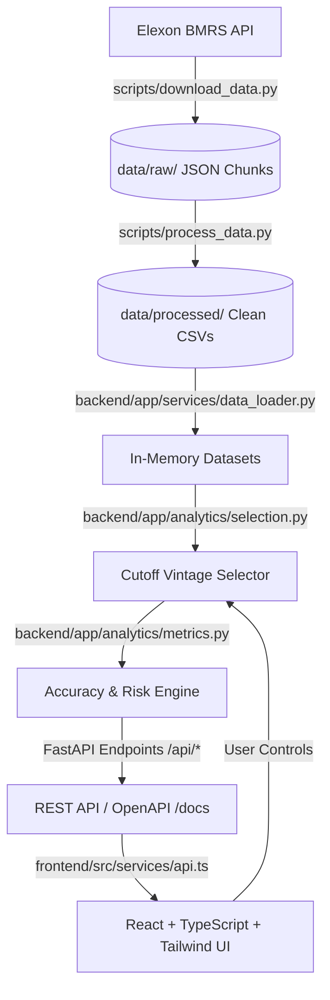

# WindScope — UK Wind Forecast Intelligence Platform

[](https://www.python.org/)
[](https://fastapi.tiangolo.com/)
[](https://react.dev/)
[](https://www.typescriptlang.org/)
[](https://tailwindcss.com/)
[](https://opensource.org/licenses/MIT)

> 🚀 **Live Production Deployment:** [https://wild-flow.vercel.app](https://wild-flow.vercel.app)  
> 📖 **API Documentation (Swagger UI):** [https://wild-flow.vercel.app/docs](https://wild-flow.vercel.app/docs) (or local: `http://127.0.0.1:8000/docs`)

---

## 1. Overview & Business Problem

Electricity trading in Great Britain's wholesale day-ahead market requires utility commercial trading teams to commit to physical power purchases before day-ahead gate closure. To minimize imbalance penalty charges and balance customer demand, utilities must accurately forecast the output of intermittent renewables, primarily **National Wind Generation**.

When wind forecasts systematically overestimate actual generation, traders under-procure from wholesale auctions and are forced into the high-volatility Balancing Mechanism (BM) or cash-out settlement, facing steep financial imbalance penalties. 

**WindScope** is a specialized analytical platform built to audit, evaluate, and quantify national wind generation forecast performance. Grounded strictly in authentic historical data from Elexon BMRS for **January 2026**, WindScope empowers commercial power buyers to:
1. **Audit Pre-Decision Accuracy:** Model forecast performance using the exact forecast vintages available at decision time under strict anti-lookahead rules.
2. **Quantify Systematic Bias:** Analyze persistent over-forecasting across delivery hours and generation levels.
3. **Analyze Horizon Degradation:** Quantify the reduction in forecast uncertainty gained by delaying purchase commitments closer to delivery.
4. **Empirically Profile Procurement Risk:** Provide non-parametric P10/P50/P90 error quantiles without synthetic demand assumptions.

---

## 2. Key Features

- **Strict Anti-Lookahead Vintage Selection:** Filters candidate forecasts so that for delivery day $D$, only forecasts published on or before the configurable cutoff on $D-1$ are eligible. Forecasts published after gate closure are strictly excluded.
- **Matched Hourly Evaluation Set (744 Hours):** Evaluates strictly the 744 hourly delivery periods where both actuals and forecasts exist. Unforecasted `:30` half-hour actuals are audited transparently without synthetic zero-filling or forward-filling.
- **Interactive Multi-Horizon Time Series:** Interactive Recharts visualizer rendering actuals and stepped forecast curves, with detailed tooltips displaying UK delivery timestamps, errors, and exact publication vintages.
- **Cutoff Sensitivity Analysis:** Instant comparative evaluation between 09:00, 12:00, and afternoon decision cutoffs, quantifying error reduction from newer forecast vintages.
- **Empirical Lead-Time Horizon Analysis:** Evaluates forecast degradation across 9 horizons (from `0h - 6h` to `48h - 72h`) across all positive-lead forecast vintages.
- **Empirical Uncertainty Quantiles:** Calculates P10, P50 (median), and P90 forecast errors and over-forecast frequencies overall and by hour of day.
- **Full Data Provenance & Audit:** In-browser audit of raw record counts, missing periods, duplicate publications, and retrospective negative-lead-time initialization rows.
- **One-Click Filtered CSV Export:** Exports the exact joined evaluation dataset (`startTime`, `actual`, `forecast`, `error`, `publishTime`) for quantitative modeling.

---

## 3. Architecture & Data Flow

WindScope is architected as a decoupled, high-performance web platform:



1. **Ingestion & Processing:** Chunks are downloaded with exponential backoff retries, validated for schemas, deduplicated, and normalized into clean CSVs.
2. **In-Memory Analytical Engine:** Processed CSVs are loaded into memory on server startup for sub-millisecond query response times.
3. **Zero Look-Ahead Selector:** For any delivery day $D$ and cutoff $HH:MM$, candidate forecasts are filtered by `publishTime <= cutoff_utc`.
4. **Presentation Layer:** Built with Vite, React 18, Tailwind CSS, and Recharts, offering responsive tablet/desktop views, robust loading/error/empty states, and full accessibility.

---

## 4. Data Sources

All data ingested into WindScope originates exclusively from official public Elexon BMRS API streams:

| Dataset | Endpoint | Parameters | Raw Records | Description |
| :--- | :--- | :--- | :---: | :--- |
| **FUELHH** | `https://data.elexon.co.uk/bmrs/api/v1/datasets/FUELHH/stream` | `fuelType=WIND` | 1,499 rows | Half-hourly national wind generation outturns across GB (settlement periods 1 to 48). |
| **WINDFOR** | `https://data.elexon.co.uk/bmrs/api/v1/datasets/WINDFOR/stream` | Late Dec 2025 to Jan 2026 | 19,856 rows | National wind generation forecast vintages published in 73-point runs (~every 2–4 hours). |

---

## 5. Scope Defined by Decision Date

The analytical scope of WindScope is defined strictly by the **decision date** on which a day-ahead procurement commitment is made:
- **Decision Dates Scope:** **1 January 2026 to 31 January 2026** (31 decision days).
- **Delivery Days Scope:** **2 January 2026 00:00 UTC to 1 February 2026 23:30 UTC** (31 delivery days; 1,488 settlement half-hours).
- **Forecast Publication Window:** To ensure pre-cutoff forecast availability for 2 January 2026, forecast ingestion captures publications beginning **30 December 2025**.

---

## 6. Assumed Decision Cutoff (Configurable Assumption)

- **Default Assumption:** **09:00 Europe/London on day $D - 1$**.
- **Nature of the Assumption:** This cutoff is an **operational workflow assumption** representing wholesale market auction bidding deadlines. It is **not** an official statutory gate closure rule.
- **Configurability:** The cutoff is fully configurable via the interactive UI selector (`09:00`, `12:00`, `15:00`, or custom time) and backend environment variables (`CUTOFF_HOUR`, `CUTOFF_MINUTE`, `CUTOFF_TIMEZONE`).
- **Strict Anti-Lookahead Rule:** Forecasts with `publishTime > cutoff` on $D - 1$ are strictly excluded from selection.

---

## 7. Hourly-vs-Half-Hourly Evaluation Set

A fundamental domain characteristic of Elexon data is the **temporal resolution mismatch** between actuals and forecasts:
- `FUELHH` actuals are recorded every **30 minutes** (48 periods per day: `:00` and `:30`). Total: **1,488 half-hours**.
- `WINDFOR` forecasts are published exclusively on the **hour** (24 periods per day: `:00`).
- **The Evaluation Set Definition:** Strictly the **744 hourly delivery periods** common to both datasets. Pre-cutoff forecast coverage is **100.0%** (744 of 744 hours matched).
- **Audit of `:30` Half-Hours:** The 744 half-hour actuals at `:30` have no forecast by design. In adherence to data integrity standards, they are **never zero-filled or synthetically forward-filled**.

---

## 8. Metric Definitions & Formulations

All forecast accuracy metrics are computed over the 744 hourly evaluation periods:

1. **Mean Absolute Error (MAE):**
   $$\text{MAE} = \frac{1}{N} \sum_{i=1}^N |f_i - a_i| \quad (\text{MW})$$
2. **Root Mean Squared Error (RMSE):**
   $$\text{RMSE} = \sqrt{\frac{1}{N} \sum_{i=1}^N (f_i - a_i)^2} \quad (\text{MW})$$
3. **Weighted Absolute Percentage Error (WAPE):**
   $$\text{WAPE} = \frac{\sum_{i=1}^N |f_i - a_i|}{\sum_{i=1}^N |a_i|} \times 100 \quad (\%)$$
   *Zero-Denominator Protection:* If $\sum |a_i| = 0$, WAPE explicitly returns `null`.
4. **Mean Bias Error (MBE):**
   $$\text{MBE} = \frac{1}{N} \sum_{i=1}^N (f_i - a_i) \quad (\text{MW})$$
5. **Approximate Energy Totals:**
   $$\text{Approx Energy} = \sum_{i=1}^{744} (\text{MW}_i \times 1\text{h}) \quad (\text{MWh})$$
   *Note: Explicitly labeled as approximate because `:30` settlement periods are excluded.*

---

## 9. Data Dictionary

| Field | Source | Type | Unit | Description |
| :--- | :--- | :--- | :--- | :--- |
| `startTime` | FUELHH / WINDFOR | ISO 8601 | UTC | Settlement period delivery start time (`YYYY-MM-DDTHH:MM:SSZ`). |
| `startTimeUK` | Processed | String | Local Time | Delivery start time in `Europe/London` local time. |
| `deliveryDate` | Processed | Date | YYYY-MM-DD | Calendar delivery date. |
| `settlementPeriod` | FUELHH | Integer | 1–48 | Elexon half-hour settlement period index. |
| `actual` | FUELHH | Float | MW | Actual national wind generation outturn. |
| `forecast` | WINDFOR | Float | MW | Selected wind forecast vintage generation value (or `null` at `:30`). |
| `publishTime` | WINDFOR | ISO 8601 | UTC | Timestamp when the forecast run was published by Elexon. |
| `leadTimeHours` | Processed | Float | Hours | Forecast lead time: $(\text{startTime} - \text{publishTime}) / 3600$. |
| `isNegativeLeadTime` | Processed | Boolean | Flag | True if $\text{startTime} < \text{publishTime}$ (retrospective initialization row). |
| `error` | Processed | Float | MW | Forecast error: $\text{forecast} - \text{actual}$. |
| `absError` | Processed | Float | MW | Absolute forecast error: $|\text{forecast} - \text{actual}|$. |

---

## 10. Summary of Empirical Findings (January 2026)

All figures below are computed directly from the processed dataset (see [`FINDINGS.md`](./FINDINGS.md) for full details):

- **09:00 Cutoff Accuracy:** MAE = **2,022.47 MW**, RMSE = **2,497.41 MW**, WAPE = **17.92%**, MBE = **+1,745.94 MW**.
- **12:00 Cutoff Accuracy:** MAE = **1,883.98 MW**, RMSE = **2,350.33 MW**, WAPE = **16.69%**, MBE = **+1,685.27 MW** (a 6.85% reduction in MAE).
- **Persistent Over-Forecasting:** **84.68% of hours** (630 of 744) were over-forecast ($f > a$). P10 error was -426.4 MW, P50 was +1,581.5 MW, and P90 was +4,154.4 MW.
- **Unexplained Bias Finding:** Forecasts exceeded actuals by roughly 1,415 to 1,900 MW in every lead-time bucket; the cause cannot be determined from these two datasets alone.
- **Worst Forecast Day:** **28 January 2026** with a WAPE of **91.79%** (Actual mean: 5,806 MW vs Forecast mean: 11,135 MW; peak error +5,329 MW).
- **Cadence Observation on 15 January:** A run was published at 12:25Z on 15 Jan instead of the usual 11:30Z; the 12:00 cutoff therefore uses the 09:30Z run for 16 Jan (producing a maximum lead time of 37.5 hours for that day).
- **Lead-Time Degradation:** Error increases slightly across horizons, from **14.71% WAPE (0h–6h)** to **20.28% WAPE (48h–72h)**.

---

## 11. Directory Structure

```
WindScope/
├── .env.example                     # Sample environment variables
├── .gitignore                       # Git ignore rules for node_modules, dist, __pycache__, logs
├── ASSUMPTIONS.md                   # Complete catalog of domain rules, scope, and assumptions
├── FINDINGS.md                      # Synthesized empirical findings generated from data
├── README.md                        # Primary platform documentation
├── docker-compose.yml               # Multi-container orchestration (backend + frontend)
├── vercel.json                      # Vercel serverless routing configuration
├── api/
│   └── index.py                     # Vercel Python serverless entrypoint
├── backend/
│   ├── Dockerfile                   # Python 3.12-slim container definition
│   ├── requirements.txt             # Pinned Python dependencies
│   ├── app/
│   │   ├── config.py                # Pydantic BaseSettings environment configuration
│   │   ├── main.py                  # FastAPI application entrypoint & middleware
│   │   ├── analytics/
│   │   │   ├── metrics.py           # MAE, RMSE, WAPE, MBE, quantiles, lead-time buckets
│   │   │   └── selection.py         # Anti-lookahead cutoff vintage selection engine
│   │   ├── models/
│   │   │   └── schemas.py           # Pydantic response models
│   │   ├── routes/
│   │   │   ├── accuracy.py          # /api/accuracy endpoint
│   │   │   ├── actuals.py           # /api/actuals endpoint
│   │   │   ├── data_quality.py      # /api/data-quality endpoint
│   │   │   ├── forecasts.py         # /api/forecasts time-series endpoint
│   │   │   ├── health.py            # /api/health endpoint
│   │   │   ├── risk.py              # /api/procurement-risk uncertainty endpoint
│   │   │   ├── summary.py           # /api/summary overview & provenance endpoint
│   │   │   └── vintages.py          # /api/forecast-vintages lead-time endpoint
│   │   ├── services/
│   │   │   └── data_loader.py       # In-memory dataset loading and caching service
│   │   └── utils/
│   │       └── validation.py        # Strict parameter validators for dates & cutoffs
│   └── tests/
│       ├── test_analytics.py        # Hand-calculated metric tests & anti-lookahead tests
│       ├── test_api.py              # FastAPI endpoint integration & error shape tests
│       └── test_data_processing.py  # Ingestion normalization & deduplication tests
├── data/
│   ├── processed/
│   │   ├── actuals_jan2026.csv      # Normalized FUELHH actuals (1,488 rows)
│   │   ├── coverage_report.json     # Data ingestion audit & completeness report
│   │   └── forecasts_jan2026.csv    # Normalized WINDFOR forecasts (19,856 rows)
│   └── raw/                         # Raw cached JSON responses from Elexon BMRS
├── frontend/
│   ├── Dockerfile                   # Multi-stage Node + Nginx Docker build
│   ├── nginx.conf                   # Nginx reverse proxy & SPA routing configuration
│   ├── package.json                 # Node dependencies and scripts
│   ├── vite.config.ts               # Vite configuration with API proxy
│   ├── vitest.config.ts             # Vitest test configuration
│   └── src/
│       ├── App.tsx                  # Tab routing & interactive state management
│       ├── index.css                # Enterprise design system & Tailwind tokens
│       ├── main.tsx                 # React DOM root entrypoint
│       ├── components/
│       │   ├── AccuracyView.tsx     # Accuracy breakdowns, worst days, error histogram
│       │   ├── Controls.tsx         # Date picker, cutoff selector, CSV export
│       │   ├── DataQualityView.tsx  # Ingestion audit & resolution explanation
│       │   ├── Header.tsx           # Enterprise header & assumption banner
│       │   ├── MainChart.tsx        # Recharts time series with stepped forecast line
│       │   ├── MetricCards.tsx      # MAE, RMSE, WAPE, Bias KPI cards
│       │   ├── RiskView.tsx         # P10/P50/P90 uncertainty distribution
│       │   ├── StateViews.tsx       # Loading, Error (retryable), and Empty states
│       │   ├── StateViews.test.tsx  # Vitest component tests
│       │   └── VintagesView.tsx     # Lead-time degradation curves
│       ├── services/
│       │   └── api.ts               # Type-safe API client supporting VITE_API_BASE_URL
│       └── types/
│           └── index.ts             # TypeScript interfaces matching backend models
└── scripts/
    ├── download_data.py             # Idempotent Elexon data downloader with retries
    ├── process_data.py              # Raw data parser, deduplicator, and validator
    └── generate_findings.py         # Empirical findings generator for FINDINGS.md
```

---

## 12. Local & Docker Execution Instructions

### A. Local Development (Without Docker)

#### 1. Backend Setup:
```bash
# Navigate to repository root and create virtual environment
python -m venv venv
# Windows: venv\Scripts\activate | Unix: source venv/bin/activate
pip install -r backend/requirements.txt

# Start FastAPI server on port 8000
python -m uvicorn backend.app.main:app --host 127.0.0.1 --port 8000 --reload
```
*Verify: Open `http://127.0.0.1:8000/api/health` and `http://127.0.0.1:8000/docs`.*

#### 2. Frontend Setup:
```bash
cd frontend
npm install
npm run dev -- --host 127.0.0.1 --port 5173
```
*Verify: Open `http://127.0.0.1:5173` in your browser.*

---

### B. Docker & Docker Compose Execution

Ensure Docker and Docker Compose are installed on your host system:

```bash
# 1. Build and launch both containers in the background
docker compose up --build -d

# 2. Verify container health status
docker compose ps

# 3. View live logs
docker compose logs -f

# 4. Stop and tear down containers
docker compose down
```

*Access Points:*
- **Frontend Application:** `http://localhost:80` (or `http://localhost`)
- **Backend API:** `http://localhost:8000`
- **Interactive Swagger Docs:** `http://localhost:8000/docs`

---

## 13. Testing Instructions

WindScope includes comprehensive test suites across both backend and frontend:

### A. Backend Test Suite (Pytest)
```bash
python -m pytest backend/tests/ -v
```
- Tests hand-calculated metrics against known manual inputs.
- Verifies zero-denominator edge cases for WAPE.
- Verifies cutoff boundaries (exact match vs 1 second after).
- Verifies strict exclusion of look-ahead forecasts.
- Verifies 400 Bad Request and 422 Unprocessable Content error handling.

### B. Frontend Test Suite (Vitest)
```bash
cd frontend
npm test
```
- Verifies `LoadingView` custom message rendering.
- Verifies `ErrorView` network timeout and 422 validation message rendering.
- Verifies `ErrorView` retry button callback dispatch.
- Verifies `EmptyView` filter reset callback dispatch.

### C. Frontend Production Build Check
```bash
cd frontend
npm run build
```
- Executes `tsc` TypeScript type-checking followed by Vite rollup minification.

---

## 14. Cloud Deployment Guide (Vercel & Render)

WindScope is designed for straightforward production deployment across modern cloud platforms.

### Option 1: Single Vercel Project (Frontend + Serverless API) — *Recommended*
Serving both the static frontend and the `/api` serverless function from a **single Vercel project** is the simplest and most robust configuration:
- **Same-Origin (Zero CORS):** Eliminates CORS configuration errors entirely because the browser makes relative requests to `/api/*` on the same domain.
- **Zero Base URL Configuration:** No need for `VITE_API_BASE_URL` build variables; requests use relative paths (`/api/summary`, etc.).
- **Atomic Deployments:** Frontend UI and backend endpoints are versioned, built, and deployed together in a single commit.

#### Deployment Steps:
1. In the Vercel Dashboard, create a **New Project** pointing to this repository.
2. Set **Root Directory:** `./` (repository root).
3. Framework Preset: **Vite** (Vercel automatically detects the frontend in `frontend/` or runs the root build script).
4. Build Command: `cd frontend && npm install && npm run build && cp -r dist ../public` (or set Output Directory to `frontend/dist`).
5. Vercel automatically detects [`api/index.py`](./api/index.py) and [`vercel.json`](./vercel.json).
6. The included [`vercel.json`](./vercel.json) routes `/api/(.*)` to the Python function and explicitly bundles the processed data:
   ```json
   {
     "functions": {
       "api/index.py": {
         "includeFiles": "data/processed/**"
       }
     },
     "rewrites": [
       { "source": "/api/(.*)", "destination": "/api/index.py" }
     ]
   }
   ```
7. *Verified Vercel Serverless Limits:*
   - **Bundle Size Limit:** Standard Python serverless functions have a **500 MB** uncompressed limit (with Fluid Compute, expandable to 5 GB). The processed WindScope dataset is ~2.2 MB, well within platform constraints.
   - **Execution Duration Limit:** Up to **300 seconds** (5 minutes) on the Hobby plan; up to **1,800 seconds** (30 minutes) on Pro plans using Fluid Compute.
   - **Included Files (`includeFiles`):** Configured via glob in `vercel.json` relative to the root (`data/processed/**`) to ensure CSV files are bundled inside the Lambda container.

---

### Option 2: Split Deployment (Separate Backend & Frontend)
If you prefer running the backend and frontend in separate projects or cloud providers (e.g. Render Web Service + Vercel Static Frontend):
1. **Backend Deployment (Vercel or Render):**
   - Deploy repository root with entrypoint `api/index.py` (Vercel) or `uvicorn backend.app.main:app --host 0.0.0.0 --port $PORT` (Render).
   - Set environment variable `CORS_ORIGINS` in **valid JSON array format**:
     `CORS_ORIGINS=["https://windscope-frontend.vercel.app"]`
2. **Frontend Deployment (Vercel):**
   - Root Directory: `frontend`
   - Build Command: `npm run build`
   - Output Directory: `dist`
   - Set Environment Variable: `VITE_API_BASE_URL=https://windscope-backend.vercel.app` (or Render URL).

---

## 15. Known Limitations & Future Improvements

1. **Intraday Gate Closure Modeling:** Currently models day-ahead cutoffs ($D - 1$). Future enhancements can evaluate intraday roll-forward horizons ($D - 4\text{h}$, $D - 1\text{h}$) using the 3,472 excluded intraday forecast vintages.
2. **Turbine-Level Curtailment Data:** Elexon `FUELHH` and `WINDFOR` datasets report aggregated national figures only. Incorporating BM Bid-Offer Acceptance (BOA) data would allow testing hypotheses regarding commercial wind curtailment.
3. **Regional GSP Granularity:** Expanding from national wind totals to Grid Supply Point (GSP) regional groups to assist localized distribution network constraint management.
4. **Machine Learning Bias Correction:** Evaluating non-linear quantile regression models to correct for the persistent positive bias (+1,415 to +1,900 MW across buckets) before wholesale bidding.

---

## 16. AI Tools Used Disclosure

In accordance with project transparency requirements:
- **AI Tools Used:** Development of WindScope was conducted using **Google Antigravity (Gemini 2.5 Flash / Claude 3.5 Sonnet)**.
- **Verification & Review:** All numbers, metrics, and data integrity checks were executed and verified against genuine Elexon BMRS data using automated Python scripts and test runners. No synthetic metrics or ungrounded statistics were generated.

---

## 17. License

This project is licensed under the MIT License — see the [LICENSE](LICENSE) file for details.
